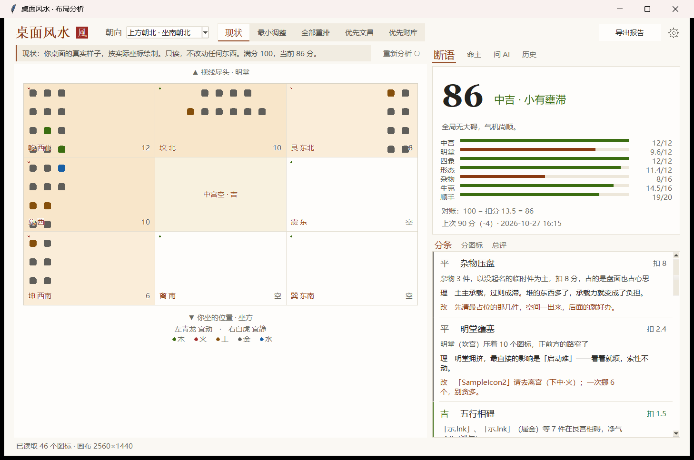
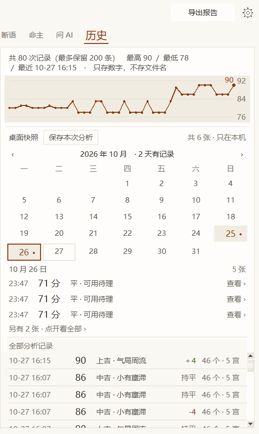
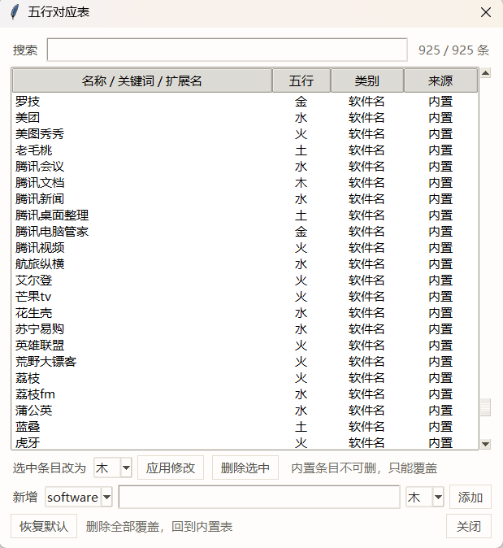

# 风水桌面 · Fengshui Desktop

把你桌面上的图标摆法，按传统形法的九宫方位与五行生克打一个分，
再把打分理由讲成人话。

**纯本地 · 只读桌面 · 不联网 · 不改任何东西。**



<p align="center">
  
  &nbsp;&nbsp;
  
</p>
<p align="center"><i>左：历史页（趋势、快照日历、全部记录）　·　右：五行对照表（925 条内置，可搜索覆盖）</i></p>

## 它能做什么

- **九宫盘面**：桌面切成三行三列，按朝向标出离南、坎北与中宫
- **七项评分**（100 分）：中宫 12 · 明堂 12 · 四象 12 · 形态 12 · 杂物 16 · 生克 16 · 顺手 20，逐项从满分起扣
- **分条诊断**：每条给「看到什么 / 为什么这么判 / 怎么动」
- **分图标**：逐件判定它与所在宫位的关系，并给出该挪去哪一宫
- **总评**：8 段散文约千字，按实际数据从 445 条文案池里选句
- **问 AI**：导出一份结构化数据 + 提问话术，拖给任意大模型即可深问
- **历史**：每日快照与分数趋势图，导出单文件 HTML 报告（无 JS、无外链）
- **五行对照表**：内置 925 条常见软件的五行归属，可搜索、可覆盖、可恢复默认

其中「顺手」这一项刻意不算吉凶：传统讲「明堂宜虚」，
但常用软件摆在顶上正中其实是手顺——它把「你实际怎么用」计入分数，
避免把好习惯判成硬伤。

## 下载

到 [Releases](../../releases) 页面下载 `FengShui-v1.0.0.exe`：单文件、免安装、无任何依赖。

## 从源码运行

Windows + Python 3.11+（用到 `ctypes` 读桌面图标）：

```bat
py -3 app\main.py
```

**零第三方依赖**（tkinter 随 Python 安装）。首次运行自动创建
`data/`、`exports/`、`reports/`，无需配置。

## 数据与隐私

所有数据只写在本机那三个目录里，不上传、不联网；
里面的历史分数只存数字与文件名哈希。导出给 AI 的文件**默认不写真实文件名**，
需在界面勾选才写。这三个目录已在 `.gitignore` 里。

## 文档与测试

- `docs/`：需求规范、技术方案、设计规范（含评分细则与文案规范）、执行步骤
- `tests/`：12 套冒烟测试（约 30 秒，无窗口模式）：

```bat
py -3 tests\_smoke_stage3.py
```

## 已知限制

- 仅 Windows（读桌面靠 Win32 API）
- 评分是**规则设计**，不是科学测量，也不预测任何现实结果——界面上一直这么写
- 文案是规则拼装而非 AI 生成，同一档位有 5 种说法

## 许可

MIT · 作者 **Snowand**
